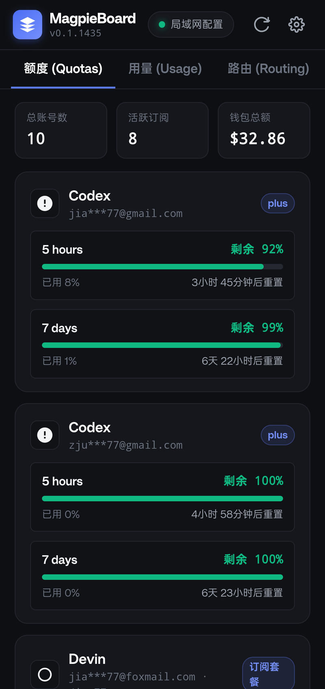
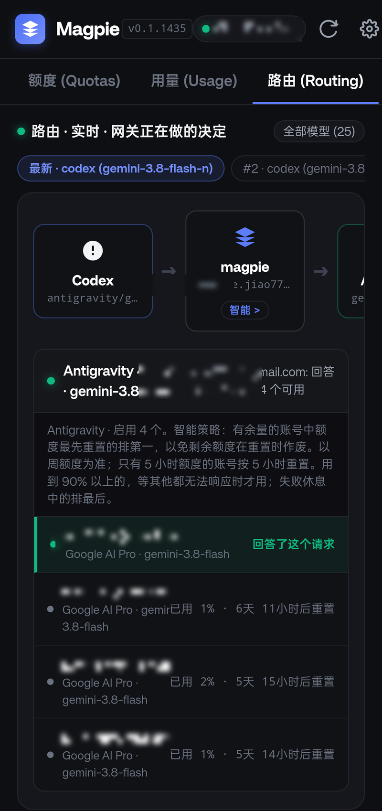

# MagpieBoard 看板 for Android

<div align="center">

# 🐦 MagpieBoard 看板

**面向 [yetone/magpie](https://github.com/yetone/magpie) 的轻量级开源 Android 监控与决策看板客户端**

[](https://github.com/Jiao77/magpie-board-android/releases)
[](LICENSE)
[](https://developer.android.com)
[](#-快速开始与下载)

<p align="center">
  随时随地通过<strong>局域网 (LAN)</strong> 或 <strong>Cloudflare Tunnel (HTTPS)</strong> 远程查看 Magpie AI 网关的账号额度、用量统计、实时路由决策与上下文窗口图谱。
</p>

</div>

---

## 📱 界面预览

| 额度面板 (Quotas) | 实时路由与决策图 (Routing & Decisions) |
|:---:|:---:|
|  |  |
| 各账号配额窗口、重置倒计时、钱包余额 | 实时调用拓扑、候选账号列表、时序切分与上下文图谱 |

---

## ✨ 核心特性

### 1. 🔀 实时路由决策与拓扑分析 (Routing & Decisions)
- **动态调用拓扑图**：还原 `[Agent 客户端]` &rarr; `[magpie 智能网关]` &rarr; `[目标供应商账号组]` 的调度流向。
- **候选账号池与优先级仲裁**：清晰呈现该组启用的全部账号，直观标注当前响应账号（`回答了这个请求`）以及各备选账号状态、剩余额度与重置倒计时。
- **决策链路溯源解释**：智能分析网关保持或切换账号的原因（如连续对话内锁定账号以复用厂商缓存）。
- **延时时序切分条 (Latency Breakdown)**：将单次交互时间精准拆分为 **magpie 内部开销**、**请求发送**、**供应商首字响应 (TTFT)** 及 **流式输出耗时**。
- **上下文窗口与提示词缓存图谱**：实时展示当前请求所占用的上下文大小（如 `398k / 1.05M tokens`）、缓存命中率（如 `99%`），并以图谱块展示提示词缓存、新增输入、输出结果及剩余可用空间。
- **历史请求快照回放**：顶部提供快捷切换标签，支持回溯排查近期的每一次路由仲裁细节。

### 2. 📊 多账号额度实时看板 (Quotas)
- **订阅套餐窗口监控**：全面兼容 Codex、Antigravity、Devin、GitHub Copilot 等多窗口配额机制，直观展示 5 小时、7 天窗口进度条与重置时间。
- **按量钱包余额汇总**：支持 DeepSeek、OpenRouter、String AI、各类聚合转 API 平台的实时余额与赠款/充值拆分。
- **隐私保护模式**：内置账号邮箱脱敏开关（一键打码显示为 `jia***77@gmail.com`）。

### 3. 📈 用量统计与趋势分析 (Usage)
- **多维度周期切换**：支持“今日”、“近 7 天”与“近 30 天”用量一览。
- **核心数据度量**：统计总花费、请求总数、输入/输出 Token、推理 Token、缓存读取量与缓存命中率。
- **可视化时序图表**：24 小时每小时调用柱状分布图、模型调用排行榜及 Agent 客户端分布。

### 4. ⚙️ 多环境配置与便捷操作 (Settings)
- **多网关独立管理**：可添加并保存多套网关配置（如 `家庭局域网`、`Cloudflare 远程`、`办公室服务器`），在顶部状态栏一键无缝切换。
- **一键粘贴与显示**：输入框支持长按与原生“一键粘贴”按钮，无需繁琐输入超长 Key。
- **连通性即时诊断**：填入配置后可一键执行握手测试，直观反馈网络延迟、网关版本与挂载模型数。
- **通用纯净设计**：默认不包含任何私有预设，代码完全公开，所有人均可开箱即用。

---

## 🚀 快速开始与下载

### 1. 下载预编译 APK
你可以直接下载仓库预编译好的已签名 APK（仅约 **57 KB**）：
- [下载最新版 APK (release/MagpieBoard-Android-v1.0.0.apk)](release/MagpieBoard-Android-v1.0.0.apk)

### 2. 通过 ADB 安装至手机
确保手机已开启开发者选项与 USB / 无线调试：

```bash
adb install -r release/MagpieBoard-Android-v1.0.0.apk
```

---

## 🔧 服务端配置准备 (Magpie Gateway)

客户端通过 Magpie 的标准 API 接口与网关通信。启动或配置 Magpie 时请确认：

### 1. 局域网访问 (LAN)
在运行 Magpie 的主机终端中启动局域网模式：
```bash
magpie web --lan
```
或者修改配置文件 `~/.config/magpie/settings.json`，确保开启局域网监听：
```json
{
  "lan": true
}
```

### 2. 获取网关密钥 (Gateway Key)
在 Magpie 配置文件 `~/.config/magpie/caller-keys.json` 或 `settings.json` 中可查阅分配的网关密钥（`lanKey`）。

### 3. 公网远程访问 (Cloudflare Tunnel)
若希望在离开家或办公室时仍可查看用量，可使用 Cloudflare Tunnel 将 Magpie 网关端口（默认为 `3425`）反向代理至自定义域名：
```bash
cloudflared tunnel run --url http://localhost:3425
```
手机端在网关地址中填入你的 HTTPS 域名（例如 `https://magpie.yourdomain.com`）即可。

---

## 🛠 本地编译构建 (Build from Source)

工程采用原生 Android 极简架构打包，提供两种便捷的编译方式：

### 方式一：使用轻量级 Python 脚本秒级构建（推荐）
配置好 `ANDROID_HOME` 环境变量后直接运行：
```bash
python3 build_apk.py
```
*构建脚本将在约 1~2 秒内自动执行 aapt2 资源打包、javac 编译、d8 字节码转换、zipalign 对齐及自签名，并在 `release/` 目录下生成 APK。*

### 方式二：使用 Android Studio 打开
1. 打开 Android Studio，选择 **Open** 并导入本项目根目录；
2. 等待 Gradle 同步完成后，点击 **Run** 或 **Build &rarr; Build Bundle(s) / APK(s)** 即可。

---

## 🔒 隐私与安全性声明

- **零第三方中转**：本客户端为 100% 独立离线架构，所有网络请求仅在你的手机与你所配置的 Magpie 网关之间直接进行。
- **本地凭据存储**：网关地址与密钥均保存在 Android 系统原生的 `SharedPreferences` 私有存储中，绝不上传至任何外部服务。

---

## 📄 开源许可证

本项目基于 [MIT 许可证](LICENSE) 开源。
